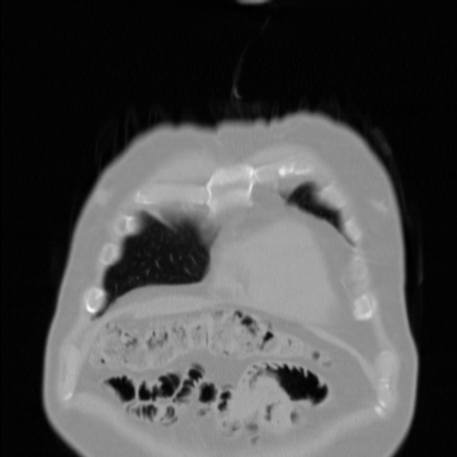
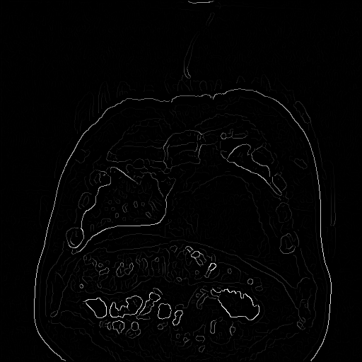
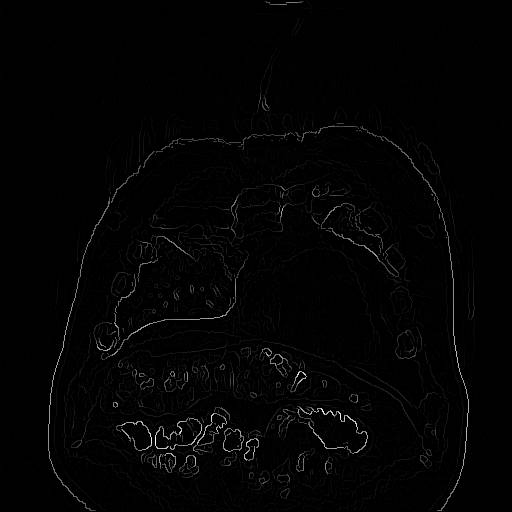
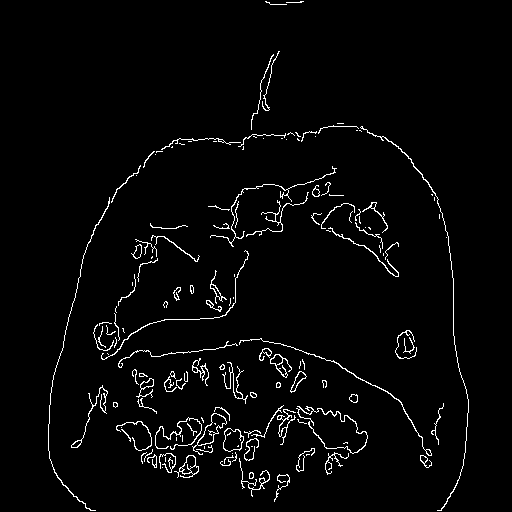
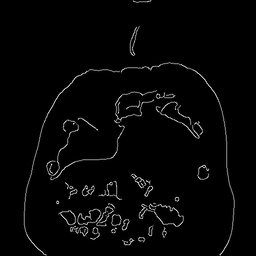

# Detecting Contours of Human Organs in 3D CT Images Using the Canny Edge Detector

This work aims to detect contours of human organs in 3D Computer Tomography (CT) images. It presents the implementation of the Canny Edge detection algorithm, the Otsu method for automatic threshold selection, and 24-connectivity to link consecutive 2D contour images, for enhancing the edge detection while using the volumetric Computer Tomography data.
For more info, check out the [report](CTMRI_3D_Edge_Detection.pdf)

---

## Pipeline

The edge detection is implemented as a multi-stage pipeline applied to each CT slice:

1. **Noise Reduction** - Two filters are tested and compared:
   - *Gaussian filter*: σ and kernel size are computed dynamically from the image diagonal (`σ = 0.002 × diagonal`, `kernel = 6σ + 1`), ensuring scale-consistent smoothing across different image resolutions.
   - *Bilateral filter*: Preserves edges better than Gaussian by considering both spatial distance and intensity difference. Parameters are also computed dynamically (`σ_r = 0.1 × std(image)`, `σ_s = 0.002 × diagonal`).

2. **Gradient Computation** - Sobel operator is applied to compute gradients in X and Y directions. Gradient magnitude (`|G| = √(Gx² + Gy²)`) and direction angle (`θ = arctan(Gy/Gx)`) are derived.

3. **Non-maximum Suppression** - Thins thick edge ridges to single-pixel-wide contours by suppressing pixels that are not local maxima along their gradient direction.

4. **Hysteresis Thresholding** - Uses two thresholds (high and low) to separate strong edges from weak ones and link them into continuous contours:
   - *High threshold*: Automatically selected per-slice using **Otsu's method**, which maximizes between-class variance of the histogram.
   - *Low threshold*: Empirically optimized by evaluating edge connectivity across candidate values of `p` (where `t_low = p × t_high`). In most cases the optimal value is `p = 0.1`.

5. **24-connectivity** - Links edges across consecutive CT slices in 3D. For each edge pixel in slice *n*, spatial correspondence is checked in slice *n+1* using 3×3 and 5×5 neighborhoods, reconstructing volumetric contours from 2D maps.

---

## Dataset

Experiments use the [CTMRI dataset](https://lbcsi.fri.uni-lj.si/OBSS/Data/CTMRI/), which contains CT scans of patients where the body is imaged in sequential axial slices forming a 3D volume. Images are read as grayscale for edge detection.

---

## Output Structure

The pipeline produces intermediate and final outputs for both filter variants:

| Folder | Contents                                                      |
|---|---------------------------------------------------------------|
| `original/` | Raw CT slices (grayscale)                                     |
| `suppressed_output_gaussian/` | Non-maximum suppression results - Gaussian smoothing          |
| `suppressed_output_bilateral/` | Non-maximum suppression results - Bilateral smoothing         |
| `hysteresis_output_gaussian/` | Hysteresis thresholding results - Gaussian smoothing          |
| `hysteresis_output_bilateral/` | Hysteresis thresholding results - Bilateral smoothing         |
| `final_output_gaussian/` | Final 3D-linked edges (24-connectivity) - Gaussian smoothing  |
| `final_output_bilateral/` | Final 3D-linked edges (24-connectivity) - Bilateral smoothing |

---

## Visual Examples

The following examples show one CT slice progressing through each stage of the pipeline.

### Original CT slice

### Stage 1 - Non-maximum Suppression

Gaussian filtering produces clean, thin edges. Bilateral filtering preserves finer structures (e.g. rib contours) but introduces more noise.

| Gaussian | Bilateral |
|---|---|
|  |  |

### Stage 2 - Hysteresis Thresholding

After double thresholding with Otsu-selected high threshold and empirically tuned low threshold, noisy weak edges are removed and strong contours are linked.

| Gaussian | Bilateral |
|---|---|
|  |  |

### Stage 3 - Final 3D Edges (24-connectivity)

Edges are propagated and linked across consecutive slices. Gaussian results remain visually cleaner; bilateral results show more detail but also more noise propagated from neighboring slices.

| Gaussian | Bilateral |
|---|---|
|  |  |

---

## Key Findings

- Both filters produce comparable non-maximum suppression results on major structures.
- **Bilateral filtering** better preserves fine structures (rib contours, small vessels) but amplifies noise, which propagates across slices via 24-connectivity.
- **Gaussian filtering** yields more stable and visually coherent 3D contour reconstructions.
- Otsu thresholding successfully adapts the high threshold to per-slice contrast variation across the CT volume.